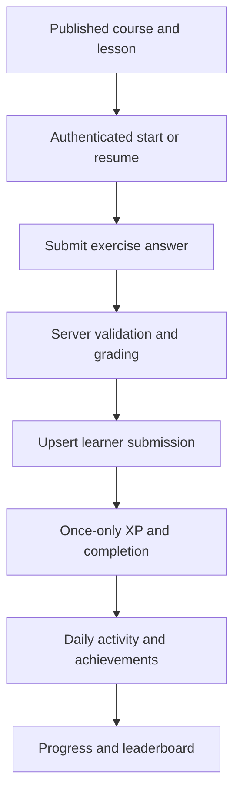
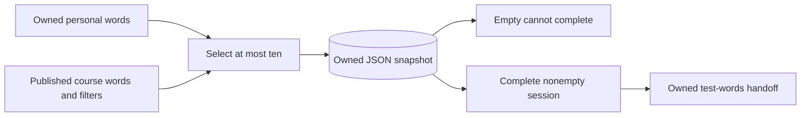
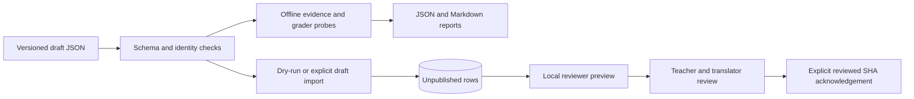

# Data flow

Flashcard completion does not award XP or implement a test grader. Snapshot content survives source-word deletion.

The SHA acknowledges an exact snapshot, not linguistic approval. Production publication is not an automatic startup step.

[Section index](README.md) · [Documentation home](../README.md)
