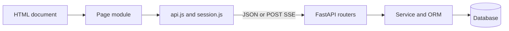

# Frontend architecture

Real HTML pages load browser ES modules and hand-written CSS. Navigation loads .html URLs with slug query parameters. api.js is the fetch boundary and holds the JWT in memory; session.js restores identity through cookie refresh and protects pages.

Shared layout/workspace modules coordinate navigation/profile and assistant integration. Page modules own transient loading/error/empty state. The assistant stores a per-user conversation pointer locally, never the token. No client state framework/router or generated API client exists. [Pages](../04-frontend/pages.md) lists entry points.

[Section index](README.md) · [Documentation home](../README.md)
