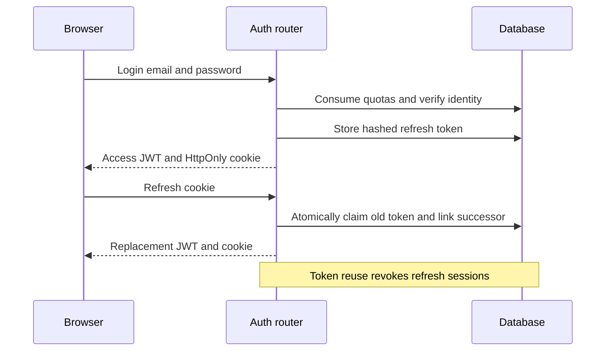

# Request lifecycle

Body-size/CORS middleware surrounds routing, Pydantic parsing and dependencies. Protected routes resolve the JWT subject to a persisted user. get_db yields an AsyncSession; handlers/services commit writes explicitly. Closing the session does not automatically commit pending work. Domain and unexpected errors map through centralized handlers.

Access JWTs remain valid until expiry after logout/password changes; refresh revocation is not an access-token denylist. [SSE](../07-ai/streaming.md) uses events for failures after headers.

[Section index](README.md) · [Documentation home](../README.md)
