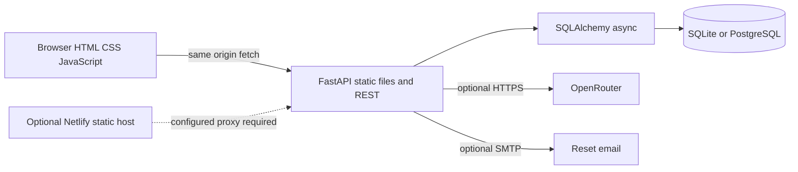

# System overview

Fleng is a modular monolith. One Python/FastAPI process serves the REST API and static HTML/CSS/JavaScript. Netlify is an optional separate static host; its checked-in API proxy is disabled. No broker, microservice, frontend build or separate AI service exists.

The database owns identities, sessions, learner results, vocabulary and AI history. Versioned JSON owns draft curriculum identities. Browser state does not determine grading/XP/ownership. [Deployment](../09-deployment/README.md) distinguishes repository configuration from live evidence.

[Section index](README.md) · [Documentation home](../README.md)
