# Relationships and entity responsibilities

- **AIConversation**: Owned model/history container.
- **AIMessage**: Content/model/usage inheriting conversation ownership.
- **AIUsage**: Owned reservation/result with unique per-user request ID.
- **Achievement**: Shared threshold definition.
- **Course**: Shared catalog publication/level/order parent.
- **CourseVocabularyItem**: Shared course word; level inherited.
- **Exercise**: Lesson question and private grading fields.
- **ExerciseSubmission**: Latest user/exercise attempt, sticky completion/once-only XP.
- **FlashcardSession**: Owned immutable JSON snapshot/completion; card IDs are not FKs.
- **LearningActivity**: Distinct user/day activity.
- **Lesson**: Course child with unique slug/theory.
- **LessonProgress**: Owned lesson start/completion state.
- **PasswordReset**: Hashed expiring one-use reset credential.
- **Profile**: One-to-one learner presentation, CEFR preference, level/XP; numeric advancement absent.
- **Progress**: One-to-one aggregate learning counters/times.
- **RefreshToken**: Hashed session with expiry/revocation/self-referencing successor.
- **RequestLimit**: Hashed scope quota-window counter, not public user data.
- **User**: Credentials/identity; private password hash; owns profile/progress/sessions.
- **UserAchievement**: Owned achievement award.
- **VocabularyItem**: Owned saved word/due schedule/optional lesson.
- **VocabularyReview**: History inheriting item ownership.

```mermaid
erDiagram
  learning_activity {
    string id PK
    string user_id FK
  }
  users ||--o{ learning_activity : "user_id"
  courses {
    string id PK
  }
  refresh_tokens {
    string id PK
    string user_id FK
    string replaced_by_id FK
  }
  users ||--o{ refresh_tokens : "user_id"
  refresh_tokens |o--o{ refresh_tokens : "replaced_by_id"
  vocabulary_flashcard_sessions {
    string id PK
    string user_id FK
  }
  users ||--o{ vocabulary_flashcard_sessions : "user_id"
  ai_messages {
    string id PK
    string conversation_id FK
  }
  ai_conversations ||--o{ ai_messages : "conversation_id"
  password_resets {
    string id PK
    string user_id FK
  }
  users ||--o{ password_resets : "user_id"
  vocabulary_items {
    string id PK
    string user_id FK
    string lesson_id FK
  }
  users ||--o{ vocabulary_items : "user_id"
  lessons |o--o{ vocabulary_items : "lesson_id"
  exercise_submissions {
    string id PK
    string user_id FK
    string exercise_id FK
  }
  users ||--o{ exercise_submissions : "user_id"
  exercises ||--o{ exercise_submissions : "exercise_id"
  progress {
    string id PK
    string user_id FK
  }
  users ||--o| progress : "user_id"
  achievements {
    string code PK
  }
  lessons {
    string id PK
    string course_id FK
  }
  courses ||--o{ lessons : "course_id"
  ai_usage {
    string id PK
    string user_id FK
  }
  users ||--o{ ai_usage : "user_id"
  users {
    string id PK
  }
  request_limits {
    string key PK
    string window PK
  }
  lesson_progress {
    string id PK
    string user_id FK
    string lesson_id FK
  }
  users ||--o{ lesson_progress : "user_id"
  lessons ||--o{ lesson_progress : "lesson_id"
  vocabulary_reviews {
    string id PK
    string item_id FK
  }
  vocabulary_items ||--o{ vocabulary_reviews : "item_id"
  course_vocabulary_items {
    string id PK
    string course_id FK
  }
  courses ||--o{ course_vocabulary_items : "course_id"
  ai_conversations {
    string id PK
    string user_id FK
  }
  users ||--o{ ai_conversations : "user_id"
  user_achievements {
    string user_id PK
    string achievement_code PK
  }
  users ||--o{ user_achievements : "user_id"
  achievements ||--o{ user_achievements : "achievement_code"
  exercises {
    string id PK
    string lesson_id FK
  }
  lessons ||--o{ exercises : "lesson_id"
  profiles {
    string id PK
    string user_id FK
  }
  users ||--o| profiles : "user_id"
```

Edges show FKs, not necessarily ORM relationship properties. User.profile/progress are one-to-one; User.refresh_tokens and Course.lessons/Lesson.exercises use delete-orphan cascades. Optional vocabulary lesson and refresh successor FKs use SET NULL; declared user/content parents generally CASCADE. JSON card IDs intentionally have no edge. Exact columns/constraints: [schema](schema.md).
