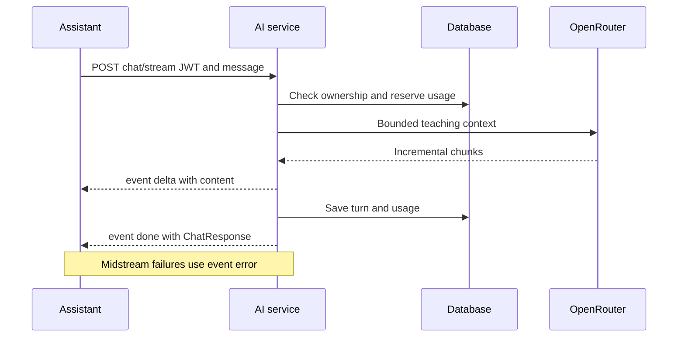

# Streaming

Transport is authenticated POST fetch streaming with text/event-stream, not WebSockets/EventSource. Before headers the backend validates and reserves usage. Headers include Cache-Control:no-cache and X-Accel-Buffering:no.

Delta JSON has content; done has conversationId/message; error has code/message. Incremental TextDecoder/parser handles UTF-8/split frames. HTTP 200 does not imply completion. Timeout, empty/oversized replies and disconnect trigger cleanup/finalized usage. Proxies must not buffer. Abort does not prove provider work was never billed.

[Section index](README.md) · [Documentation home](../README.md)
